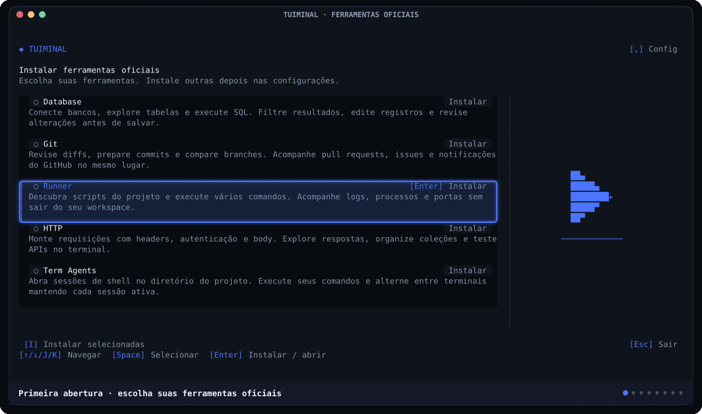
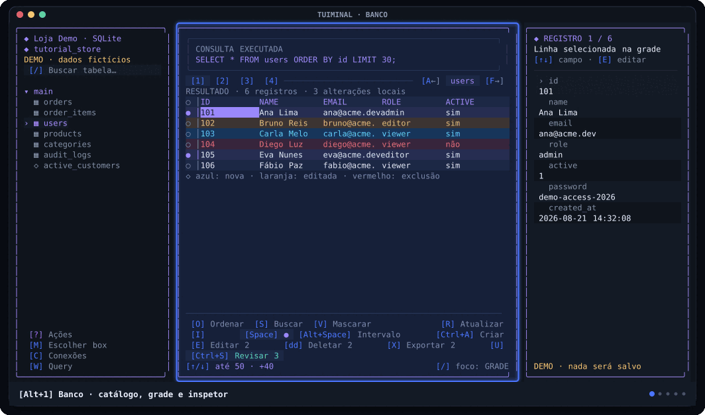
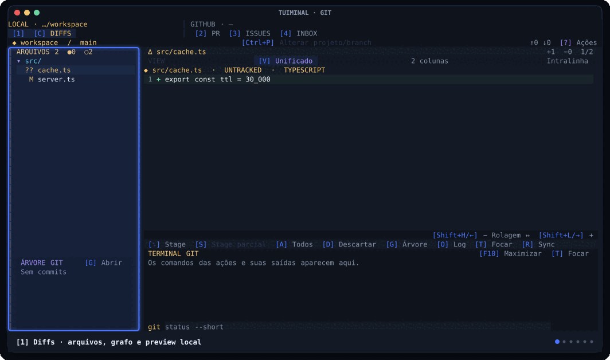
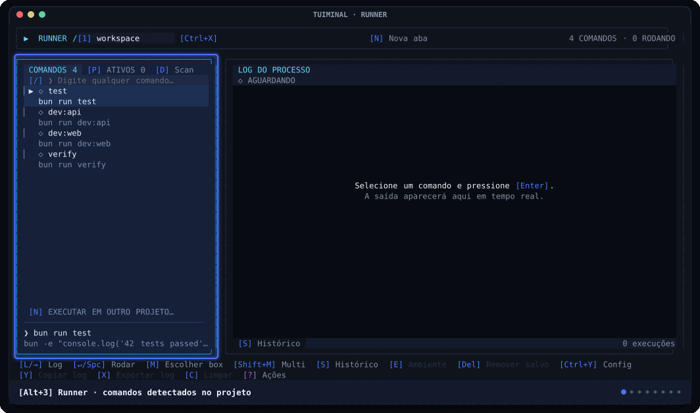
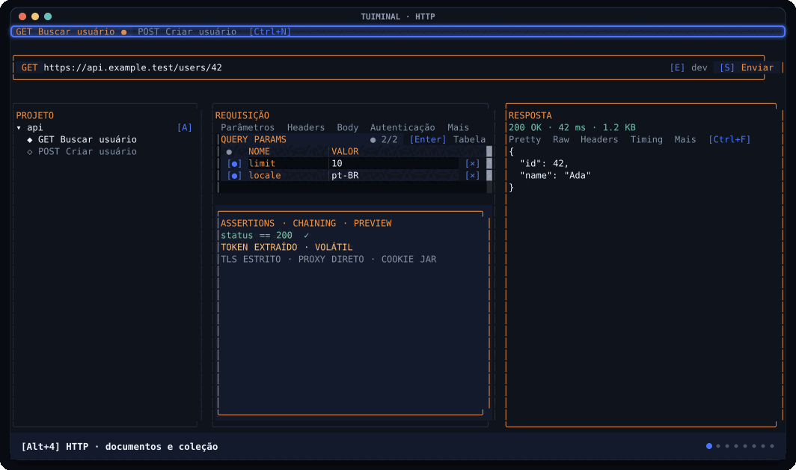
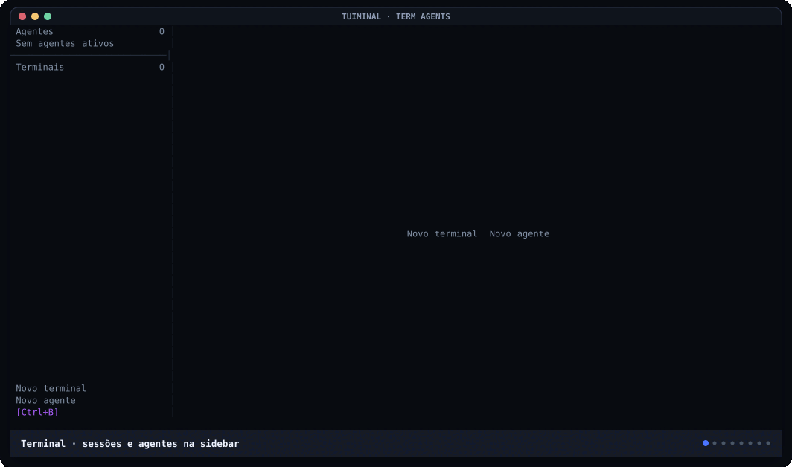

<div align="center">

# Tuiminal

**English** · [Português (Brasil)](./README.pt-BR.md)

<a id="um-workspace-completo-de-desenvolvimento-dentro-do-terminal"></a>

### A complete developer workspace inside your terminal.

Databases, GitHub, processes, APIs, and real terminals in one fast, responsive interface.

[](https://www.npmjs.com/package/tuiminal)
[](https://github.com/DeividXupon/tuiminal/releases)
[](./LICENSE)
[](#installation)

[Install](#installation) · [Database](#database) · [Git](#git) · [Runner](#runner) · [HTTP](#http) · [Term Agents](#term-agents) · [Contribute](#development)

</div>

> [!WARNING]
> Tuiminal is in **beta**. You can install and try it, but shortcuts, formats, and APIs may change between versions.

Tuiminal keeps your workflow in one place. Open a project once and switch between its database client, Git interface, processes, HTTP client, and terminals with `[Alt+1–5]`.

- Dense interface built with Bun, OpenTUI, React, and tuiparts.
- Works in any directory; Git, Runner, and terminals use the project passed to the CLI.
- Full keyboard and mouse support.
- A solid block follows the mouse with a bright ASCII particle trail. Text stays
  readable; the effect works over notifications and embedded terminals, survives
  clicks and selection, and clears when you type.
- Framed layout with one continuous panel surface, or compact layout with its denser
  canvas; eight palettes and seven languages.
- Processes and PTYs stay alive when you switch tabs.
- Explicit protections for sensitive data, writes, and remote operations.

<a id="instalação"></a>

## Installation

Install the beta from npm:

```bash
npm install --global tuiminal@beta
tuiminal
```

You **do not need to install Bun** to use the published package. npm downloads the binary for macOS, Linux glibc, or Windows on x64 and ARM64. The small package launcher requires Node.js 22 or later.

A fresh installation opens **Install official features**. Choose Database, Git, Runner,
HTTP, or Term Agents with `[↑/↓]` / `[J/K]` or the mouse, then press `[Enter]` to
install and again to open. Use `[Space]` and `[I]` to install several tools. Reopen
this screen through `[,]` → **Official features → Manage features** or
`tuiminal features`. Only installed tools appear in the tabs; Runner is the default
when available. Downloads are version-matched and verified, and live in Tuiminal's
own data directory, outside your projects.

Installed tools have a **[D] Uninstall** button. Confirm with `[Y]` or cancel with
`[Esc]`. Uninstalling closes that tool's sessions and discards unsaved work while
preserving projects and saved settings. You can install it again from the same screen.

For scripted setup: `tuiminal features install git runner` or `tuiminal features install all`.

Each tool includes a detailed description. Hover over a row or navigate with
`[↑/↓/J/K]` to see an animated icon for the tool. Database fills a storage cylinder;
Runner plays, progresses and completes; HTTP sends a request and receives a response
between a client and server. Git shows a branch, and Term Agents shows a window
with a blinking cursor. Icons adapt to smaller terminals.
During a download, the tool's row fills from left to right with its actual progress.




To update or uninstall:

```bash
npm install --global tuiminal@beta
npm uninstall --global tuiminal
```

<a id="primeiros-passos"></a>

## Getting started

Open the current directory, another project, or a single tool:

```bash
tuiminal
tuiminal ../meu-projeto

tuiminal banco ./meu-projeto
tuiminal git ./meu-projeto
tuiminal runner ./meu-projeto
tuiminal http
tuiminal terminal ./meu-projeto
```

The aliases `database`/`db`, `run`, and `term`/`tty` are also accepted. In isolated mode, hidden tools are not initialized. Only these commands and aliases are treated as tools; other names are directory paths.

`tuiminal --version` prints the version without loading settings or UI. `tuiminal --help` and the other commands use the configured language, or English when none is saved.

<a id="navegação-global"></a>

### Global navigation

All bracketed keyboard hints stay blue, including action palettes and selected or disabled controls.

| Action | Shortcut |
| --- | --- |
| Open Database | `[Alt+1]` |
| Open Git | `[Alt+2]` |
| Open Runner | `[Alt+3]` |
| Open HTTP | `[Alt+4]` |
| Open Term Agents | `[Alt+5]` |
| Open settings | `[,]` |
| Quit | `[Q]`, `[Esc]`, or `[Ctrl+C]` |

On macOS, `Alt` corresponds to `Option`. If your terminal sends `¡`, `™`, `£`, `¢` or `∞` for `Option+1–5`, Tuiminal also recognizes them as tool shortcuts outside focused inputs, editors, terminals and dialogs. Unmodified numbers remain available for actions within each tool. For other keyboard layouts, enable **Use Option as Meta key** or the equivalent setting; in [Ghostty](https://ghostty.org/docs/config/reference#macos-option-as-alt), use `macos-option-as-alt = true` (or `left` to keep the right Option key available for symbols).

All tools share compact notifications on the right: at the bottom while Database is active and at the top in other tools. At most three cards remain visible without taking keyboard focus. Every card has a thin colored countdown line and enters and leaves with a short animation. Information is blue, success is green, and errors are red and remain visible a little longer. Hovering any card pauses every visible notification and resumes all countdowns when the pointer leaves.

To copy text, drag with the left mouse button to select it, then right-click the
selection. This also works in isolated tools and dialogs. Copying uses the terminal's
OSC52 clipboard support; if it fails locally, the selection remains available to retry.
Masked password fields copy only their mask.

<a id="cinco-ferramentas-um-único-fluxo"></a>

## Five tools, one workflow

| Tab | Purpose |
| --- | --- |
| `[Alt+1]` Database | Explore data and schemas, write SQL, and prepare transactional changes. |
| `[Alt+2]` Git | Review local diffs, PRs, Issues, and GitHub notifications. |
| `[Alt+3]` Runner | Discover commands, run services, and follow multiple logs. |
| `[Alt+4]` HTTP | Build, save, send, and automate API requests. |
| `[Alt+5]` Term Agents | Run shells and any CLI in compact sections of up to two terminals. |

<a id="banco"></a>
<a id="database"></a>

## Database

<p align="center">
  
</p>

A responsive database explorer with a catalog, grid, inspector, and SQL workspace. No connection is created automatically: the first launch opens the connection manager. In framed mode, the panels use the full workspace height, with outer spacing only at the sides.

The table header keeps `[1]` Data, `[2]` Columns, `[3]` Indexes and `[4]` Schema on the left, with recent tables and `[A←]` / `[F→]` on the right of the same line. Narrow terminals shorten labels and show fewer recent tables while keeping the active one visible. A horizontal divider separates the table footer from the grid. The footer groups sorting, search, masking and refresh on its first row, with selection, editing and review evenly spaced across the row below; narrow terminals use a third action row. `[H/L]` and `[←/→]` navigate cells and adjacent panes without a permanent navigation hint.

<a id="o-que-você-pode-fazer"></a>

### What you can do

- **Connect:** MySQL/MariaDB, PostgreSQL, SQLite, and optional MySQL MCP servers. In the connection form, `[A←]` / `[F→]` cycles database tabs outside text fields; `[Esc]` leaves the current field. MCP is always explicit and read-only.
- **Explore:** schemas, tables, and views; inspect records, columns, indexes, DDL, constraints, and relationships. `[/]` filters the catalog; `[Enter]` moves from the filter to the matching table list, and a second `[Enter]` opens the selected table. In `[4]` Schema, `[G]` toggles a one-hop ASCII relationship diagram for the open table; narrow terminals stack each foreign-key connection vertically.
- **Find data:** sort the active column, search all columns, and scroll horizontally while keeping the selected row. The table grid keeps up to 50 fetched rows and loads 40 more at either edge when you press the direction key again. Each table read shows a syntax-colored SELECT preview in a notification, including its table and `LIMIT`/`OFFSET`; projected columns and search literals are abbreviated.
- **Select batches:** `[Space]` marks rows; `[Alt+Space]` sets an anchor and `[↑/↓]` grows or shrinks a spreadsheet-style range. Marked rows have a subtle background tint in tables and SQL results, while the active cell keeps its stronger highlight.
- **Review writes:** stage `INSERT`, `UPDATE`, and `DELETE` locally. `[Ctrl+S]` opens review and executes the approved batch in a single transaction.
- **Edit large selections:** indexed lookup of staged changes preserves snapshots and exact `BigInt` keys before review.
- **Preserve decimals:** `DECIMAL`, `NUMERIC`, and `MONEY` values retain their entered digits through submission, including scientific notation. Database precision and scale still apply.
- **Write SQL:** keep up to six independent tabs, execute only the statement under the cursor, cancel queries, and adjust the editor/result split. Results keep at most 50 fetched rows; pressing `[↓]` again at the last row or `[↑]` again at the first loads the next overlapping block of 40. Layout changes and maximization preserve the editor and draft.
- **Inspect and export:** view every field in a row and export marked rows as CSV, TSV, or JSON.
- **Protect information:** mask sensitive columns on demand and customize the terms used to identify them.

<a id="fluxo-de-escrita"></a>

### Write workflow

1. Open a table or run an editable simple `SELECT`.
2. Use **Edit** (`[Enter]`/`[E]`), **Create** (`[Ctrl+A]`), or **Delete** (`[dd]`) to stage changes; **Undo** (`[U]`) discards the selected pending changes.
3. Review the local-change indicators in the grid.
4. Open **Review** with `[Ctrl+S]`, review every statement, and confirm again.
5. Tuiminal executes one transaction; a failed statement rolls back the entire batch.

Repeated rapid confirmations do not duplicate an in-flight execution. Approved statements cannot be changed during the transaction.

SQL results are editable only when they directly select columns or `*` from one identifiable table. Expressions, aliases, duplicate columns, aggregates, grouping, `DISTINCT`, and ambiguous queries remain read-only. Editing or deleting requires the complete primary key in the result.

In MySQL, unqualified double-quoted fields remain read-only because they may be string literals; prefer backtick-quoted identifiers. Double-quoted columns remain editable in PostgreSQL and SQLite.

Profiles start **read-only**, with the `READ-ONLY` toggle checked. In the connection form, `[Ctrl+W]` or a click unchecks it to enable writes; the label stays the same. Toggle it again to restore read-only mode. Passwords are not written to configuration JSON: when requested, they go to macOS Keychain, Linux libsecret, or Windows Credential Manager. `DATABASE_URL`, `MYSQL_URL`, and `POSTGRES_URL` can be discovered without silently becoming editable profiles. The password field stays masked while editing and resizing, including wide characters such as ideographs and emoji.

Connection inputs accept exported shell environment variables as `{DB_HOST}`, `{DB_PORT}`, or `{DB_PASSWORD}`, including references inside text such as `{HOME}/data/app.sqlite`. Type `{` to see variable names, use `[↑/↓]` to select and `[Tab]` or `[Enter]` to complete; `[Esc]` dismisses suggestions first. Export variables before launching Tuiminal (for example, `export DB_HOST=localhost`). Suggestions never show values. Saved fields keep references; password references follow the existing Keychain/session setting. Undefined variables and invalid ports block connection attempts.

The connection manager also lists session-only profiles from MySQL `~/.my.cnf`, `mysql_config_editor`, PostgreSQL `~/.pg_service.conf`, and `~/.pgpass` (including the corresponding Windows locations). `[R]` refreshes discovery. Missing fields are requested for the current session; external passwords are never copied into Tuiminal settings. Saved PostgreSQL profiles can use `pgpass` instead of Keychain. On Unix, secrets in files with unsafe ownership or permissions are ignored. Discovered external profiles enable writes, while the same staged review and explicit confirmation remain mandatory.

MySQL groups such as `[client_dev]` and `[client_test]` appear as separate profiles. Each inherits `[client]`/`[mysql]` defaults and merges the matching `[mysql_dev]` or `[mysql_test]` overrides; groups with a hyphen suffix are also supported. Incomplete profiles appear in the connection manager so you can fill in missing fields without re-entering a safely loaded password. Discovery progress and warnings are shown instead of treating these configurations as absent. `!include` and `!includedir` directives are reported but are not followed.

Connection tests release temporary clients on failure as well as success. Environment URL passwords are decoded once, and a passwordless URL does not inherit the previous password.

Native reads use PostgreSQL `READ ONLY` transactions, MySQL/MariaDB transaction and session protection, and a read-only SQLite handle in the editor, even for writable profiles. Unknown routines, state-changing PRAGMAs, and effectful commands require enabled writes and confirmation. Use least-privilege server credentials: application mode is not a sandbox for database routines. Optional MCP servers and their credentials must enforce read-only access themselves.

New SQL history entries store metadata only. Full SQL, parameters, and detailed errors stay in a session cache limited to 200 entries and 2 MB. After shutdown or eviction, metadata remains without rerun capability. In Database settings, `[D]` opens legacy-content cleanup and `[Y]` confirms it: metadata and favorites are preserved, but cleanup cannot be undone and does not remove backups. **Explicitly saved favorites still write full SQL to disk**; avoid saving secrets in them.

Export previews process only the first visible rows and retain the original language of values. Copying or saving includes the entire selection in CSV, TSV, or JSON.

<a id="atalhos-essenciais-do-banco"></a>

### Essential Database shortcuts

| Action | Shortcut |
| --- | --- |
| Search Database / SQL actions | `[?]` outside text inputs, or the `[?]` button |
| Choose a Database / SQL box | `[M]` outside text inputs (or choose it in `[?]`), arrows or `[H/J/K/L]`, then `[Enter]`; `[Esc]` cancels |
| Manage connections | `[C]` |
| Data, columns, indexes, and schema | `[1]`, `[2]`, `[3]`, `[4]` |
| Schema details / relationship diagram | `[G]` in Schema |
| Navigate rows | `[J/K]` or `[↑/↓]` |
| Open table or edit cell | `[Enter]` |
| Search tables / search data | `[/]` / `[S]` |
| Sort column | `[O]` |
| Mark row / select range | `[Space]` / `[Alt+Space]` |
| Export selection | `[X]` |
| Previous / next page | `[P]` / `[N]` |
| Previous / next table | `[A←]` / `[F→]` |
| Open SQL workspace | `[W]` |
| Execute current SQL statement | `[Ctrl+A]` |
| Cancel query | `[Ctrl+X]` |
| New / close SQL tab | `[Ctrl+N]` / `[Ctrl+W]` |
| Switch SQL tabs | `[Alt+←/→]` |
| Adjust split / maximize pane | `[+/-]` / `[F10]` |
| Review staged writes | `[Ctrl+S]` |
| Refresh data and catalog | `[R]` |

On macOS, focus a grid cell, press `[Option+Space]` once, then use `[↑/↓]` to extend the range. Press the shortcut again to stop extending it; `[Esc]` clears the selection. `[Ctrl+Space]` opens SQL autocomplete in the editor and is not a range-selection shortcut. If Ghostty does not forward `[Option+Space]`, add this [key binding](https://ghostty.org/docs/config/keybind/reference#text) to its configuration:

```ini
keybind = alt+space=text:\x1b\x20
```

Reload Ghostty's configuration with `[Cmd+Shift+,]`. If the combination opens another application, release its shortcut there first; Ghostty cannot override shortcuts intercepted by macOS or another app.

Connection settings and history metadata live in `~/.config/tuiminal/databases.json`, retaining up to 100 recent reads and 184 days of writes. New entries do not persist SQL, parameters, or diagnostics; sensitive-column terms belong to global settings.

<a id="git"></a>

## Git

<p align="center">
  
</p>

A lazygit-style local workspace and three remote dashboards inspired by gh-dash. Diffs works offline; PR, Issues, and Inbox load separately when first opened.

Navigation separates the local project from the GitHub account:

```text
LOCAL · …/tuiminal      │ GITHUB · @account
[1] [C] DIFFS           │ [2] PR  [3] ISSUES  [4] INBOX
```

The local label follows the selected project. GitHub shows the account already loaded
by the active remote tab, or `—` before one is available; the header makes no extra
GitHub requests. Narrow terminals stack the two groups. `[C]` switches the local
view between Diffs and Compare.

### `[1] Diffs`

- Groups changed files into a real tree. Unbranched directory chains show each folder on its own line without artificial indentation; `[J/K]` treats the chain as one navigable block.
- Distinguishes staged, unstaged, and untracked files using Git's two-character status.
- Shows unified, side-by-side, or intraline previews with syntax highlighting and old/new line numbers. Character-level comparison is computed only in intraline mode and reused until the document changes. Git previews and Term Agents Live Diff share offline syntax highlighting for Python, Go, Rust, C/C++, C#, Java, PHP, Ruby, Bash, JSON, YAML, TOML, SQL, Lua, Kotlin, Swift, Elixir, HTML, CSS, XML/SVG, Svelte, Dockerfile, and TSX, alongside the built-in JavaScript, TypeScript, Markdown, and Zig support. Parsers load on demand; unknown file types remain readable as plain text.
- Keeps a small commit graph below the tree. `[G]` expands it; `[O]` opens a `git log`-style history with a colored graph spanning each commit block. Blocks include hash, branches/tags, merge parents, author/email, relative date, file count, `+/-` statistics, subject, and message body.
- `[Space]` stages/unstages the selected file or all descendants of a folder, including names containing `*`, `?`, brackets, or `:`. `[A]` stages a folder's descendants or toggles all files when a file is selected. Colors update immediately; subsequent staging actions remain available, and confirmation reloads only status. The mounted preview reconciles silently without a loader or scroll reset; the graph refreshes in the background only when refs change.
- `[Enter]` on a tree file opens and focuses its diff. With a tracked text file focused, `[S]` opens partial staging in unified mode. Unstaged and staged panes sit side by side and include hunks already in the index so they can be removed. `[S]` switches hunk/line mode without losing pending transfers or highlighting; `[H/L/←/→]` switches panes, `[J/K]` navigates, and `[Space]` transfers an item. Scrolling keeps the entire target above the action row even for uneven hunk heights. The Git terminal is hidden while partial staging is open, and `[Tab]` stays within its two panes. `[Enter]` and `[Esc]` apply the displayed state and exit. The active hunk has a full-height blue left rail; file changes during selection cause safe rejection.
- In a focused diff, `[Shift+H/L]` or `[Shift+←/→]` scroll to the last character, with clickable controls at the lower right. Numbers, signs, and change backgrounds remain fixed. Split-mode code scrolls together without hiding either column. Vertical navigation preserves horizontal position; leaving the diff resets it to the left.
- The project/branch header centers `[Ctrl+P]`, with the project/branch on the left and ahead/behind counts plus `[?] Actions` on the right, without change or staged/unstaged counters. It retains its space while navigating the tree, including when a larger diff finishes loading. Diffs and Compare use horizontal outer padding only, with no blank spacer rows around their panels. The permanent Diffs navigation footer is omitted to leave more room for content.
- `[D]` discards the selected file or folder after explicit confirmation, restoring tracked changes and removing new files.
- A Git terminal below the diff shows seven rows and retains up to 2,000 history lines of actual command output. `[T]` focuses it for manual commands; `[↑/↓]` and mouse scroll output; `[F10]` maximizes/restores it within the preview pane. The `git` prefix is fixed, without shell command composition. Autocomplete suggests commands, options, known local/remote branches, tags, remotes, and changed files: `[Ctrl+N/P]` navigates, `[Ctrl+Y]` applies, and `[Esc]` dismisses.
- `[C]` switches to **Compare**, comparing two known refs through `base...compared` without checkout or uncommitted changes.
- `[Ctrl+P]` chooses another local repository/branch without changing PR, Issues, or Inbox scope. In the terminal it belongs to autocomplete; it cannot open settings over a modal or partial staging.
- The Git tutorial demonstrates both local modes in tab `[1]` using simulated data. Diffs covers the header, changed-file tree, mini commit graph, preview, actions, terminal, navigation, and `[Ctrl+P]`, `[Space]`, `[G]`, `[O]`, `[V]`, `[S]`, `[D]`. It then enters `[C] Compare`, opens simulated project/base/compared selectors, explains `base...compared`, and shows the commit-only summary, grouped tree, selected diff, three layouts, and return via `[C]` or `[Esc]`. Stateful steps show the resulting view; the tutorial never discovers projects, runs Git, fetches refs, or accesses GitHub. It then enters `[2] PR` (scope, queues, search, all preview tabs, file diff, creation and approval), `[3] Issues` (sections, details, comments, creation and triage), and `[4] Inbox` (notifications, conversations, read marks, saving, completion and unsubscribe). These 25 remote steps display fictional results and confirmation dialogs; they never invoke `gh`, open a browser, persist settings or submit actions.
- The Term Agents tutorial walks from the basics to advanced use with a simulated online-store project: PTY panes, the metadata strip, sessions and folders, the New agent button, the Master Key menu and `[1]`–`[9]`, rename, box selection, splits, the Agents list, the provider/project/folder/environment pickers, resume threads, sent-message history and turn details, every Live Diff area and its project picker, the pinned sidebar, tmux mirrors, remote agents, project sync review/progress/automatic sync and the server setup guide. Each step opens the view it explains. The tour paints over the live workspace, so real terminals keep running at their size and receive no input; it never spawns processes, reads Git, discovers projects or connects over SSH.

PR, Issues and Inbox place `[?] Actions` beside their screen title and omit the
navigation footer and blank outer rows. A horizontal rule separates each title from
the Git tabs above it. Wide PR and Issues screens place sections
and creation on one row; narrower screens stack them. Section tabs alternate subtle
theme backgrounds while the active tab keeps its highlight. Preview placement is automatic,
without hide/position commands. Lists and focused preview details load the next page
as navigation or scrolling reaches the end, without a manual load-more command.

### `[2] PR`

- `[Ctrl+N]` opens a creation form with searchable repository, remote base, and compare branch pickers, plus title, Markdown description, and a draft option. The base starts with the selected repository's default branch and remains selectable. The title starts with the latest commit subject from the compare branch and remains editable. Tuiminal checks both selected branches before one GitHub API submission; it does not push a local branch.
- Starts with **My PRs**, **Review requested**, **All**, **Open**, and **Closed**. The last three select non-archived PRs by state within the current scope.
- Lists state, repository, review, CI, author, assignees, comments, labels, and diff size.
- State marks are green for open, purple for merged, gray for draft, and red for closed.
- Preview tabs show overview, checks, activity, commits, and files.
- Stopping CI watch or closing its screen cancels the active request; old responses neither notify nor interrupt a new watch.
- Activity uses the same comment layout as Issues: author, date and reactions share a header, replies stay grouped, and selection stays visible while scrolling. `[J/K]` selects comments, reviews and events in display order; on a comment, `[E]` opens five quick reactions (👍 ❤️ 🎉 😄 👀), and `[Enter]` replies with a reference to the original comment. Replies group under their parent; a comment with reactions offers a new reaction. `[Shift+E]` reacts to the PR itself.
- Remote diffs open inside Tuiminal and preserve the queue on return.
- Queries and sections use GitHub qualifiers with autocomplete for `repo:`, `author:`, `review-requested:`, and other filters.
- Comments, reviews, merges, and other writes use preparation, reauthentication, remote-state rereading, and confirmation before execution.

### `[3] Issues`

- `[Ctrl+N]` opens a creation form with a searchable repository picker, title, and Markdown description. Both creation forms keep the draft in memory until submission and require `[Ctrl+S]` to create.
- Starts with **My Issues**, **All**, **Open**, and **Closed**, selecting non-archived issues by state within the current scope.
- Combines a dense two-line list with overview and activity previews.
- Its state mark is green for open and red for closed.
- In Activity, `[J/K]` selects comments, `[E]` reacts with 👍 ❤️ 🎉 😄 or 👀, and `[Enter]` replies. Replies group under the parent; existing reactions do not hide the new-reaction control. `[Shift+E]` reacts to the issue itself.
- Supports comments, assignment/unassignment, label edits, branch creation with checkout, closing, and reopening.
- Searches remain scoped to non-archived issues and never accidentally become GitHub-wide searches.

### `[4] Inbox`

- Combines Inbox, review requests, assignments, mentions, and locally saved items.
- Issue and PR notifications show the conversation inside the preview, with Overview and Activity tabs (`[Z/V]`). Activity shares the Issues layout, including reactions (`[E]`), replies (`[Enter]`), and automatic pagination. Notification actions stay above the conversation.
- `[J/K]` navigates the focused pane. In narrow terminals, preview replaces the list; `[H/Esc]` returns to the same notification. Other notification types keep their metadata preview.
- Filled and hollow marks still distinguish unread and read. PR and Issue marks also take the subject's state color, with a text label; other subjects or unavailable states stay neutral.
- Marking read is explicit; completing and unsubscribing require confirmation.
- Automatic refresh preserves visible data when the network fails.

PR and Issues use the `origin` repository when recognized. Outside a repository, the default is the authenticated account, explicitly including organizations and external repositories rather than searching all of GitHub. Remote views require [GitHub CLI](https://cli.github.com/) 2.40.0 or later.

While a PR or Issues tab is active, its visible list and selected details refresh about every 30 seconds, so issues and comments added in GitHub appear without reopening the tab. `[R]` checks both immediately. The configured longer interval still refreshes every section to its loaded page depth.

When `gh` is missing or outdated, PR, Issues, and Inbox explain it, display the detected official command, provide `[C]` to copy, and offer a mini terminal focused with `[Enter]` or mouse. Tuiminal starts only the shell: you paste and execute the command, and version detection updates automatically. `[Enter]` reopens an exited shell. Missing authentication uses the same guidance for `gh auth login --hostname <host> --web`; `gh`/GitHub own login and tokens, and the view reloads when the account is detected.

Automated `gh` calls have time limits and wait for process exit on cancellation. A PR/Issue write without confirmation—because of timeout, cancellation, output limits, or incomplete input—is never replayed automatically. Check remote state before retrying.

Switching PR/Issue details releases pagination immediately; stale responses cannot replace a newer refresh. Repeated load-more actions in one event batch issue one request. PR discussion changes invalidate the detail cache even if the head SHA stays the same. PR, Issues, and Inbox reuse row text during navigation while keeping language, colors, and data current.

Git settings appear as five rows opened by `[,]`: Diffs under **GIT**, with Pull Requests, Issues, Repositories, and Browser under **GITHUB**. Moving with `[J/K]` or `[↑/↓]` renders the focused row immediately; `[Enter]` or `[L]` moves keyboard focus into its detail pane, and `[Esc]` returns to the rows. A blue left rail marks the focused pane, and the focused row shows a blue `[Enter]`. Local projects and remote repositories appear independently as each discovery finishes. Leaving or reloading the Git context cancels its old remote request. Project/branch pickers and PR/Issue section editors replace the same detail pane and return with `[Esc]`; no second settings modal is opened. Query autocomplete processes only enough candidates to fill visible suggestions.

In Git, open `[,]` → Context → Browser to choose where `[O]` opens PRs, Issues, Inbox notifications, and workflow runs. The default uses your system browser. Browsh and Carbonyl run in an integrated Git terminal; close that view with `[Ctrl+Q]`. `terminal-browser` opens a separate terminal pane. Install the chosen browser command on your `PATH` before opening a link. This Git-wide choice is saved in `~/.config/tuiminal/git-browser.json`.

Repeated `[Enter]` presses do not repeat an in-flight project/branch selection. Leaving a picker with `[Esc]` or its button prevents a late response from closing a replacement picker. Leaving does not cancel or undo an already-started Git command.

Quoted query text stays literal: mentioning `repo:` or `author:@me` inside a phrase does not remove account scope. Values such as `label:"help wanted"` retain spaces. Unclosed quotes must be completed before submission; applying or saving an incomplete query shows a warning in the same context pane while preserving text and focus.

<a id="atalhos-essenciais-do-git"></a>

### Essential Git shortcuts

| Action | Shortcut |
| --- | --- |
| Open Diffs, PR, Issues, or Inbox | `[1]`, `[2]`, `[3]`, `[4]` |
| Toggle Diffs / Compare | `[C]` |
| Navigate list | `[J/K]` or `[↑/↓]` |
| Switch tree, preview, and Git terminal focus | `[Tab]`; `[H/L]` or `[←/→]` between tree and preview |
| Scroll a focused diff horizontally | `[Shift+H/L]` or `[Shift+←/→]` |
| Change section | `[A←]` / `[F→]` |
| Change internal preview tab | `[Z←]` / `[V→]` |
| Open remote diff | `[D]` |
| Open the action palette in any Git tab: search every action by block tag, with unavailable ones explained; in Diffs, its right column switches the versioned project or the observed local branch. The empty search field shows `[/] Search` when unfocused | `[?]` |
| Choose a box in any Git tab (Diffs: tree, preview, Git terminal; GitHub tabs: list, preview) | `[M]`, then `[H/J/K/L]` and `[Enter]` |
| Open selected PR, Issue, or Inbox notification | `[O]` |
| Create a PR or issue in its tab | `[Ctrl+N]`, then `[Ctrl+S]` |
| Stage file/folder or all files | `[Space]` / `[A]` |
| Stage hunks or lines in the focused diff | `[S]`, then `[S]`, `[H/L/←/→]`, `[J/K]`, `[Space]`, and `[Enter]` |
| Discard file/folder with confirmation | `[D]` |
| Focus Git terminal | `[T]` |
| Open local history / graph | `[O]` / `[G]` |
| Change diff layout | `[V]` |
| Change Diffs project/branch | `[Ctrl+P]` |
| Edit remote query | `[/]` |

Remote scope is saved in Git profiles. The local Diffs selection is separate in `~/.config/tuiminal/git-diffs.json`; the browser choice lives in `~/.config/tuiminal/git-browser.json`; saved Inbox items live in `~/.config/tuiminal/git-inbox.json` with `0600` permissions.

<a id="runner"></a>

## Runner

<p align="center">
  
</p>

Runner is Tuiminal's initial screen. It discovers project commands, starts short- and long-running processes, and keeps logs, input, and history in the same workspace.

Open `[,]` → **Tutorial** while Runner is active for a guided tour of commands,
processes, logs, Multi, YAML, flows and autostart review. Every demonstration uses
simulated data; your project files and running sessions stay intact. Use `[Enter]`
to advance, `[←]` to go back and `[Esc]` to return to your workspace.

<a id="o-que-você-pode-fazer-1"></a>

### What you can do

- **Discover automatically:** JavaScript scripts, Composer/PHP, Laravel, Symfony, Python/Django, Go, Rust, Ruby/Rails, Maven, Gradle, .NET, Deno, Taskfile, Makefile, justfile, and Docker Compose.
- **Run any command:** the manual field accepts literal command text; `[Ctrl+S]` saves a name and explicit PTY option.
- **Start or stop commands:** `[Enter]`, `[Space]` or a click starts an idle command or stops its active execution. Use `[L/→]` to view logs without stopping it.
- **See execution status:** tabs, command rows, history and log headers use the theme's running accent, green for success, red for failure and yellow for checks or shutdown. Project tabs show status through the name color, without a symbol beside it. Command names stay white; only their indicators change color, without status text in the command list. Commands retain their latest result; the header counts belong to the selected project. Health indicators remain separate from process status.
- **Follow logs:** switch stdout/stderr, filter, copy, export, show timestamps, and send input to stdin or a PTY.
- **Watch multiple services:** Multi mode shows up to three logs side by side and navigates additional groups.
- **Order commands and services:** dependencies wait for successful completion or startup with health checks. Cycles and missing references are rejected before execution; failure or cancellation blocks pending dependents.
- **Save project flows:** `[Ctrl+Y]` opens the YAML configuration file inside the terminal. Create named flows with sequential and parallel stages, then run, stop or restart them from the TUI.
- **Edit commands locally:** configure literal command, directory, environment/profile, PTY, restart policy and health checks, including overrides for detected commands. The editor shows documentation, validation and keyboard/mouse suggestions without changing project files.
- **Switch projects:** `[N]` opens another repository/directory without interrupting active processes. Up to four projects occupy local tabs `[1]–[4]`.
- **Use detected ports:** open or copy a URL, or send it directly to the HTTP tab.

Logs update in batches and retain up to 1,200 entries, with per-entry and per-process size limits. Clearing a log also discards output pending display; final lines remain visible after exit.

Single and Multi retain the original language of program output; only Tuiminal messages are translated. Port discovery waits for each probe before starting the next and cancels only its own helper when leaving the context.

Project discovery deduplicates overlapping directories and performs up to 16 concurrent reads, with limits of 300 projects and seven levels. Detected commands use the selected project's paths. Deno JSONC task text is preserved even when it contains comment markers.

Discovery reads `.tuiminal/runner.yaml`, `mprocs.yaml`, `Procfile`, `Procfile.dev`, `Taskfile`, `Makefile`, and other supported formats. Only explicit `autostart: true` in Tuiminal configuration, including locally saved commands and flows, can request automatic startup. The first request shows the project, commands, directories, profile, and variable names for approval. Trust is local, and a material configuration change requires renewed confirmation. `mprocs` and `Procfile` never start implicitly.

```yaml
version: 1

profiles:
  development:
    envFile: .env.development
    env:
      LOG_LEVEL: debug

commands:
  api:
    command: npm run dev
    profile: development
    cwd: services/api
    restart: on-failure
    maxRestarts: 5
    health:
      type: http
      url: http://127.0.0.1:3000/health
      timeoutMs: 30000
```

<a id="atalhos-essenciais-do-runner"></a>

Edit `commands`, `flows` and `profiles` as YAML with syntax colors and contextual help. A read-only recommendation list follows the cursor as you type or move with arrows, shows options for the current YAML block, and describes the selected option beside the list. After `flows:` and `[Enter]`, it shows an example flow ID (`dev:`); while you type another ID, it shows the required colon, then offers fields such as `label` and `stages` inside that flow. The same guidance appears for command and profile IDs and environment variable names. Close typos show likely alternatives from that block; unrelated text closes the recommendation list. Use `[Ctrl+J/K]` or a mouse click to inspect options; type the desired key or value yourself. `[Enter]` indents the next line for mappings, list entries and literal command blocks; `[Tab]` inserts two spaces. `[Esc]` dismisses recommendations, then returns to command/flow management. Dependencies use `dependsOn` entries with `commandId` and `condition`; flow stages use `commandIds` and `waitFor`. `started` waits for the configured health check. `[Ctrl+S]` validates and saves. See the [Runner specification](docs/design/runner.md) for complete YAML examples.

### Essential Runner shortcuts

The command footer includes Multi, history, environment, saved-command removal, and log copy, export and clearing. With the log focused, the footer also exposes filtering, stream selection and timestamps. While the log filter is being edited, the footer shows only `[Enter] Apply`, which keeps the filter and returns to the log, and `[Esc] Close`. Both footers wrap their shortcuts to fit the terminal width. The header's `[N] New tab` button sits between the existing tabs and command summary and opens the project picker. The `[/]` button beside the command input focuses that field; pressing `[/]` does the same. `[P]` switches between commands and active processes, and `[D]` refreshes discovery, using the buttons in the command-panel header or their shortcuts.

The action palette lists commands with categories and reasons for unavailable actions. Use `[/]` to search, `[↑/↓]` or `[J/K]` to navigate, and `[Enter]` or a click to choose. `[Esc]` leaves search before closing the palette and restoring focus. Existing shortcuts remain available.

| Action | Shortcut |
| --- | --- |
| Start or stop the selected command | `[Enter]` / `[Space]` |
| Focus manual command / save | `[/]` / `[Ctrl+S]` |
| YAML editor | `[Ctrl+Y]` |
| New command / flow (management list) | `[Ctrl+N]` / `[Ctrl+F]` |
| Run / stop / restart selected flow | `[Ctrl+R]` / `[Ctrl+K]` / `[Ctrl+T]` |
| YAML newline and indentation / suggestions / save | `[Enter]` and `[Tab]` / `[Ctrl+Space]` / `[Ctrl+S]` |
| Browse YAML recommendations | `[Ctrl+J/K]` |
| Commands / active processes | `[P]` |
| Choose a panel | `[M]`, arrows or `[H/J/K/L]`, then `[Enter]`; `[Esc]` cancels |
| Single / Multi view | `[Shift+M]` |
| Previous / next Multi group | `[A←]` / `[F→]` |
| List → log / log → list | `[L/→]` / `[H/←]` |
| Expand / collapse history | `[S]` |
| Search actions | `[?]` (also `[A]` in Single / `[Shift+A]` in Multi) |
| Open another project | `[N]` |
| Switch Runner projects | `[1]`–`[4]` |
| Close project tab without stopping processes | `[X]` |
| Export selected log | `[Ctrl+X]` |

The active Runner tab shows a red `[X]`; inactive tabs show `×`. Plain `[X]` closes the active tab outside text inputs and dialogs.

The YAML editor saves `~/.config/tuiminal/runner/<project-hash>/runner.yaml`, without changing project files. Existing saved commands and flows are included on the first save. `runner.json` retains sessions, history and legacy definitions for projects without YAML. Logs persist only through opt-in or export to `tuiminal-logs/`. Tuiminal stops only processes it started when exiting.

<a id="http"></a>

## HTTP

<p align="center">
  

Postman collections and folders open **Settings** from `[A]` or a double-click. Collections offer **Authorization**, **Scripts**, and **Variables**; folders offer **Authorization** and **Scripts**, including inherited parent authentication. `[Ctrl+S]` saves to Postman while preserving drafts on failure.
</p>

A compact API client with documents, collection, request builder, response inspection, and automation. Its interactive data lives in one global HTTP home (`$XDG_DATA_HOME/tuiminal/http`, or `~/.local/share/tuiminal/http`) regardless of the opened project. Layout adapts from three columns to split or single-pane views without losing drafts, cursor, response, or focus. Tabs and action bars wrap in narrow panes so body formats, Copy, and Save remain accessible. Request tables expose Add/Edit controls, and a running response has a clickable Cancel action. HTTP dialogs share a dimmed background, a consistent header and responsive actions; collection import separates choosing a file from reviewing and confirming it.

<a id="o-que-você-pode-fazer-2"></a>

Dialogs highlight the request, file or destination being changed. Confirmations,
imports and Postman pickers keep their actions in wrapping footers; long form
details scroll while the focused field stays visible. Import previews separate
request, skipped-item, warning and conflict counts, and response comparisons use
distinct before/after context.

### What you can do

- **Build requests:** method, URL, query parameters, headers, JSON/text/XML, URL-encoded forms, multipart, file bodies, and Bearer, Basic, API Key, or OAuth2 authentication. The Body editor highlights JSON and XML syntax; TEXT remains plain. `[Tab]` inserts two spaces without changing focus, and `[Esc]` leaves the editor.
- **Inspect responses:** status, duration, size, headers, timing, Pretty/Raw, search, JSONPath, copy, save, and comparison. Valid JSON receives formatting and colors, with tree controls in a separate gutter and a full-row highlight on the selected block. With the response focused, `[↑/↓]` or `[J/K]` navigates blocks, `[←/→]` collapses/expands, and `[Enter]` toggles the current block. Navigable Pretty JSON keeps one row per line for accurate selection. Other views use colored tables: Raw has numbered lines; Headers show names and values; Timing shows measured phases and percentages; Summary, Cookies, Redirects, Assertions and Console have their own columns. Narrow panes stack fields without dropping data, and wrapped cells remain searchable. Success, failures and warnings have distinct colors; values in the Cookies tab remain masked.
- **Control space:** the workspace/collection pane widens when focused and returns to its normal width when you move elsewhere, keeping the request and response usable. Request/response starts at `50/50`; `[+/-]` and the drag handle share a per-document ratio limited to 25–70%.
- **Save collections:** import and save interoperable `.http`/`.rest` files in the global HTTP home without silently rewriting unsupported blocks.
- **Organize collections with keyboard or mouse:** move through the collection tree with `[↑/↓]` or `[J/K]`, collapse and expand with `[←/→]`, and open requests with `[Enter]`. Create folders, `.http` collections, and requests. `[A]` or a right-click opens a menu beside the selected row: folders/collections offer Add request, Add folder, Rename, Duplicate, and Delete; collections also offer Run collection, and local directories offer New collection. Requests offer Rename, Delete, and Duplicate. New folders/requests and renamed items use a single-line input directly in the tree; `[Enter]` saves and `[Esc]` cancels. While saving, an animated loader appears beside the name in the same row; a failed save leaves the name available to retry. Empty folders and collections remain visible in gray; names with requests use the theme’s main text color. Deletion opens a persistent, focused notification with a softly glowing border: `[Enter]` confirms and `[Esc]` declines, then focus returns to the tree. Changed or running open requests must be handled first.
- **Import:** enter a full path or `~/` path to a Postman v2.0/v2.1 or OpenAPI 3.0/3.1 file, use `[↑/↓]` and `[Tab]` to complete it, or drop a file into the import box when the terminal pastes its path. Tuiminal detects the format from the file contents and shows it in the conversion preview with loss warnings; the resulting `.http` is saved in the global HTTP library only after confirmation, independent of the opened project.
- **Upload files:** Body → File has a native file chooser above a dotted drop area. Choose or drop one or several files from any folder. One file in File sends a raw body; selecting several switches to Multipart with one editable `file` field per attachment. Multipart shows full Text/File type labels and lets you add more files, change field names and remove each row; names must match the receiving API. `[Backspace]` removes the raw-file selection and cancelling keeps the current selection. macOS and Windows use system dialogs; Linux uses Zenity or KDialog when available. Terminals can paste a dropped path, including escaped spaces or a local file URL. File and multipart uploads accept files outside the HTTP library, including symlinks, up to 256 MB. File controls preserve navigation and global shortcuts; isolated letters are not interpreted as file paths.
- **Connect a Postman account:** run `tuiminal postman login` for a prompt that does not echo the API key, or pipe a key to `tuiminal postman login --api-key-stdin`; add `--region eu` for an EU account. HTTP always starts with the Local and Postman cards; `[Ctrl+G]` returns to them. Choosing Postman immediately opens the last used workspace and environment, or the first accessible workspace. Connection errors keep the cards available for retry or Local selection. Postman loads workspaces, collections, folders, and variables directly from the API, keeping account data in memory without local `.http` copies or sidecars. Use the workspace menu to switch workspaces and `[E]` to open environments. Collections retain their original names and stable remote IDs, including repeated request names and drafts without URLs. `[A]` or right-click offers create, rename, duplicate, and delete actions; `[?]` opens the action palette. `[Ctrl+S]` saves directly to Postman and confirms the result; new requests ask for a destination collection or folder. Failed saves leave edits open and unsaved; `[Ctrl+P]` retries the same save. Unrelated remote changes are preserved, and simultaneous changes to edited fields are reported as conflicts. Form, Multipart, and File bodies retain file references without uploading file contents. Reopening a workspace or request reads current API data; there is no offline collection fallback. The API key uses the OS credential store by default. Explicit CLI `pull`/`push` commands remain available for local copies. See [Postman account access](./docs/design/postman-account.md) for supported fields and boundaries.
- **Postman login troubleshooting:** if the API accepts the key but it cannot be saved, the CLI shows a red explanation and yellow recovery steps. Interactive login then warns and asks whether to save the key in a local file without encryption; only `Y` followed by `[Enter]` accepts, and the default is no. The file stays in the global HTTP home with owner-only permissions where supported. Both HTTP and the CLI can use it without the OS credential store. A later secure login removes the local copy; `logout` clears the saved key. Piped input never enables this fallback. See [credential storage](./docs/design/postman-account.md).
- **Postman save troubleshooting:** custom Tuiminal Options, Assertions, and Chaining cannot be saved to Postman. The error identifies which section to reset before retrying. Cleared proxy fields, empty assertions, and removed chaining do not block saving other edits; failed saves keep the draft open.
- **Concurrent script edits:** Pre-request and Post-response are saved independently. Editing one preserves remote changes to the other; conflicting edits to the same script keep the draft unsaved.
- **Request selection:** Local and Postman open with the collections sidebar focused and without an automatic Scratch. Until you select a call, the Tuiminal and Postman logos replace the request and response panels. Closing or deleting the last call returns to this view; unsaved edits require confirmation. `[Ctrl+N]` explicitly creates a draft. In Postman, `[Ctrl+S]` asks for a destination only after edits or a prefilled URL; confirmed deletions need no save.
- **Run request scripts:** the **Scripts** tab contains **Pre-request** and **Post-response** JavaScript editors with syntax highlighting. Nested tabs `[Z←]`/`[V→]` select the phase, `[Enter]` edits, and `[Esc]` exits editing; `[Tab]` indents. Scripts use the Postman engine, including `pm.environment`, `pm.globals`, `pm.collectionVariables`, `pm.variables`, `pm.request`, `pm.response`, `pm.expect` and `pm.test`. Environment/global/collection changes remain in the current workspace session, isolated by environment and collection, without automatic remote writes. Tests appear with response assertions; a pre-request error prevents sending, while a post-response error keeps the response. Scripts are saved with the request in Local or Postman mode. Each phase has a two-second execution limit; collection/folder scripts, additional scripted requests, Vault, Visualizer and flow-control APIs are not supported.
- **Read and edit request docs:** open **More → Docs** to read the request description as scrollable Markdown. `[Enter] Edit` opens the complete source; `[Esc] Preview` keeps the draft. `[Ctrl+S]` saves to the selected source: a local file in Local mode or directly to the API in Postman mode.
- **Automate:** status/header/body/JSONPath assertions and guided Chaining. Search for a previous request and review the execution order, then extract variables from JSONPath, response headers or HTTP status. Each extraction has enable/disable and secret controls, validation and a preview from the last response. Reuse values as `{{variable}}` later in the same run; open drafts participate in the chain.
- **Run collections:** resolve dependencies topologically, use JSON/CSV datasets, limit concurrency, and emit text, JSON, or JUnit reports. Selection works with duplicate request names. The runner separates request selection, parallel dataset cases and optional data. `[Tab]` moves between fields; Enter in the data field focuses Run, while `[Ctrl+Enter]` starts execution. Run/Cancel stays visible while configuration and results scroll. Target and parallelism controls are locked during execution. Reopening the runner cancels the previous run; stale results cannot replace the new one.
The active HTTP tab shows a red `[X]` close button. Press `[X]` outside text inputs to close it; unsaved changes still require confirmation. `[W]` exports cURL, `[Esc]` cancels requests or collection runs after leaving focused inputs, and `[Shift+M]` beside the method cycles it. HTTP split resizing uses `[+]` to increase and `[-]` to decrease, outside text editors.

- **Use environments:** `[E]` opens the workspace's environment list in place of History, with highlighted **Global** first and the other environments below. Click an item or use `[Enter]`, `[→]` or `[L]` to open and focus its table in a tab beside requests. Each named environment has an `[A]` menu with only **Use environment** and **Delete**, without first opening a tab; deletion asks for confirmation. `[M]` includes the environment table in box selection. Moving up past the first variable selects Name in blue; `[Enter]` or a click starts editing, and `[↓]` returns to the table. `[←/H]` past the variable column returns to the list. While browsing, `[,]`, `[Q]`, `[M]` and `[?]` remain available; text fields retain typed characters. Global keeps its fixed name and cannot be deleted. Its **Variable / Value** table fills the request/response area. Arrows select a highlighted cell, `[Enter]` edits, and `[Esc]` returns to the table, then the list. `[Tab]` reaches actions; while editing, `[Tab/Shift+Tab]` moves through fields. `[Home/End]` scrolls to the first/last row, `[Alt+←/→]` switches tabs without losing edits, and `[Ctrl+S]` saves. `[N]` creates an environment, the name field renames it, and Delete asks for confirmation. **Use environment** activates it for requests; opening a tab alone does not change the active environment. Drafts survive tab changes and failed saves, and closing a changed tab asks before discarding. Local values use the OS credential store with opaque file references. Postman reads and writes the selected workspace's shared values through the API, preserves variable metadata, and rejects a save if the remote environment changed since it was opened.
- **Edit request tables:** in Query/Path Params, `[J/K]` or `[↑/↓]` chooses a block. `[Enter]` starts the first cell of an empty table or opens navigation over existing rows. Arrows or `[H/J/K/L]` reach the enabled dot, name/value cells, and `[×]`; `[Enter]` activates the selected control, including deletion on `[×]`. `[Space]` enables or disables the selected row, and `[Tab]` advances through inputs into a draft row that becomes real when typed. `[Esc]` steps back from input to table to block. Headers, form URL encoded, and Multipart use the same flow; Multipart also exposes its text/file switch in table navigation. `[N]` is no longer used to add table rows. Tables share aligned Name/Value columns, a type column for multipart, active/total counts, alternating rows, and contextual footer hints. Disabled entries are dimmed. Query and Path Params each use 50% of the available height, even when empty, with independent scrolling. Other empty sections stay compact; scrolling keeps the selected cell visible through resize.
- **Authorize with OAuth2:** choose **OAuth2** in Auth for Client Credentials or Authorization Code with PKCE (S256). Configure token/authorization URLs, client credentials, scope and optional audience; fields accept environment variables. `[Ctrl+T]` gets a token, `[Ctrl+R]` refreshes it, and `[Esc]` cancels a pending authorization outside text inputs. For PKCE, register the displayed loopback callback with your provider, then open or copy the browser link. Expiring tokens refresh automatically for individual sends and collection runs. Tokens stay in memory for the session; saved requests contain configuration only, and previews/cURL omit issued tokens. Store client secrets in private environment variables. Headless runs support Client Credentials; PKCE requires the interactive login.
- **Edit authentication and details:** authentication uses labeled full-width fields and masks tokens, passwords, and API key values. Assertions and Chaining use separate rows with Add/Delete controls; `[N]` also adds to an empty list. Authentication uses `[Enter]` to open the form, `[Tab]`/`[Shift+Tab]` to move between fields, and `[Esc]` to return to pane navigation. Chaining uses `[J/K]` or `[↑/↓]` to select items, `[H/L]` or `[←/→]` to select fields/actions, and `[Enter]` to activate. Leaving an input with `[Esc]` or `[Enter]` restores selection; its help stays in a fixed footer. Assertions opens in row selection: `[J/K]` or `[↑/↓]` selects an item and `[Enter]` edits it. `[Esc]` or `[Enter]` returns to selection; `[Tab]`/`[Shift+Tab]` leaves the input and selects the next/previous item. Examples remain in a fixed footer while rows scroll. Preview groups the prepared request, headers, variables, and body with private values masked.
- **Adjust request options:** More → Options has three blocks selected with `[J/K]` or `[↑/↓]`. `[Enter]` enters Options; move vertically through alternating rows and press `[Enter]` to change a setting or edit the proxy below them. Identity places Name and Method side by side with inline labels: enter the block, select with `[H/L]` or `[←/→]`, then press `[Enter]` to type. `[Esc]` returns from input to items to blocks. Actions stay at the bottom with alternating button backgrounds; select that block, move horizontally and press `[Enter]` to activate directly. Narrow strips scroll to the selected action. The selected options row shows `[R] Default` to reset only that setting; timeout and redirects return to inheritance. Actions have no individual letter shortcuts. The active Options or Identity heading shows `[Enter] Select` before entry and `[Esc] Exit` inside the block; both hints are clickable.
- **Complete request variables:** type `{{` in URLs, query/path parameters, headers, authentication, raw bodies, form/Multipart text fields, or proxies. Suggestions follow the cursor: `E` has a blue background for the active environment, `G` green for globals, and `C` brown for collection variables. The selected row shows its value immediately below. `[↑/↓]` selects, `[Tab]` completes `{{name}}`, and `[Esc]` dismisses. Completed `{{name}}` references are light blue. Hold the mouse or text cursor over one for one second to open its scope/value tooltip. `[↓]` focuses the value; `[Esc]` saves and returns to the request. Leaving an edited value also saves it in its original scope, while failures retain the draft for retry. Names and values both support variables; query pairs such as `?manga=2` appear in Params without sending duplicates.
- **Control transport:** timeout, redirects, cookie jar, HTTP/HTTPS proxy, and TLS. Cookies use Public Suffix List validation and bounded storage isolated by environment and collection directory. The Cookie jar row disables both cookie reads and writes per request. Disabling TLS verification is explicit, visibly red, and requires approval per destination.
- **Review sensitive redirects:** sending a private body/URL to another origin or downgrading HTTPS to HTTP pauses for authorization. `[Y]` continues that hop; `[Esc]` refuses. The confirmation shows destination and risks with known private values masked. Cancellation cannot undo a request already received by the previous server.
- **Handle external responses carefully:** `[O]` opens only allowlisted raster images with matching MIME and signatures. SVG, PDF, generic binaries, and disguised content cannot open through the system handler, but can be explicitly saved. Full download resends only GET, caps at 256 MB, and removes partial files on failure. Repeated activation does not duplicate downloads; closing the owning document cancels them. Completed files are published only after all bytes are written, without replacing an existing destination.

<a id="atalhos-essenciais-do-http"></a>

HTTP keeps up to six numbered tabs. Opening another replaces the last tab, asking before discarding unsaved changes. The tab bar scrolls to keep the active tab visible.

Select the workspace name in the tree with the mouse or `[Home]`, then press `[A]` or `[Enter]` for **New collection**, **Select workspace**, or **New workspace**. New workspace asks for a name, creates a personal workspace through the Postman API, and opens it. Failed creation keeps the name available to retry; `[Esc]` cancels before submission. Right-clicking the workspace name opens the same menu. New collections in the active workspace use an inline name input; `[Esc]` cancels. In Local mode, the workspace menu offers New collection, New folder, and Import collection. Choose Run collection from a collection’s menu to open the runner scoped to that file; `[T]` cycles only its requests, and `[Ctrl+Enter]` starts execution. The former Commands control and its collection-tree shortcuts have been removed.

The Postman workspace chooser shows call totals on the right, including nested folders. Counts load in the background; `…` means loading and `—` means unavailable.

### Essential HTTP shortcuts

The Request `[R]` and Response `[Shift+R]` title buttons focus their panels. Text
inputs and modal dialogs keep ownership of typed keys.

| Action | Shortcut |
| --- | --- |
| Switch route, collection, request, and response | `[Tab]` / `[Shift+Tab]` or `[H/L]` |
| Focus URL / send / cancel | `[/]` / `[S]` or `[Enter]` / `[X]` |
| Open searchable actions | `[?]` (or `[F1]`) |
| Choose a visible box | `[M]`, arrows or `[H/J/K/L]`, then `[Enter]`; `[Esc]` or `[M]` cancels |
| Next method | `[Shift+M]` or click the method |
| Cycle Params, Headers, Body, Auth, and More with request focused | `[A←]` / `[F→]` |
| Cycle nested Body, Auth, or More options | `[Z←]` / `[V→]` |
| Switch Query Params / Path Params | `[J/K]` or `[↑/↓]` |
| Enter a request table / edit a selected cell | `[Enter]` |
| Move through request table controls / inputs | `[H/J/K/L]` or arrows / `[Tab]` |
| Enable/disable a request table row / delete via selected `[×]` | `[Space]` / `[Enter]` |
| Navigate / collapse / expand JSON | `[↑/↓]` or `[J/K]` / `[←/→]` / `[Enter]` |
| Open environments | `[E]` |
| Switch main response view / internal tab | `[A←]` / `[F→]` · `[Z←]` / `[V→]` |
| Open collection / environments | `[C]` / `[E]` |
| Navigate collection rows / first or last row | `[↑/↓]` or `[J/K]` / `[Home/End]` |
| Collapse or expand / open selected request | `[←/→]` / `[Enter]` |
| Collection / folder / request / workspace actions | `[A]` or right-click |
| Confirm / refuse deletion | `[Enter]` / `[Esc]` |
| Select a numbered tab (outside text fields) | `[1]`–`[6]` |
| New / close tab | `[Ctrl+N]` / `[Ctrl+W]` |
| Switch documents | `[Alt+←/→]` |
| Save `.http` | `[Ctrl+S]` |
| Adjust split / maximize | `[+/-]` / `[F10]` |
| Open jump mode | `[Ctrl+O]` |

A versionable request example:

```http
### Buscar usuário
# @name buscar-usuario
# @depends login
# @extract-secret token = $.token
# @assert status == 200
# @assert jsonpath $.id exists
GET {{baseUrl}}/users/42
Authorization: Bearer {{token}}
```

The same engine also runs without opening the UI:

```bash
tuiminal http run api.http#buscar-usuario --env local --report text
tuiminal http run api.http --data cases.json --concurrency 4 --report junit
tuiminal http import postman collection.json --output .tuiminal/http/imported
tuiminal http import openapi openapi.yaml --output .tuiminal/http/imported
tuiminal postman workspaces
tuiminal postman collections <workspace-id>
tuiminal postman environments <workspace-id>
tuiminal postman pull <workspace-id> <collection-id> --environment <environment-id>
tuiminal postman push postman/<file>.http "<request-name>"
```

Headless redirects carrying a private body/URL require `--allow-private-redirect-to https://destino.example`; downgrades require `--allow-http-redirect-to http://destino.example`. Each flag accepts an exact origin (scheme, host, and port), can be repeated for additional destinations, and lasts only for that invocation. When both risks apply, both authorizations are required. `--allow-insecure-tls` is separate. Even with approval, private/authentication headers from the original origin are not forwarded. Continuing does not replay the previous request or collection dependencies. Timeout and cancellation dismiss pending confirmations; late approvals send nothing. Insecure TLS in the UI retains `[I]` approval by destination, environment, and session.

Responses are captured up to roughly 1.5 MB and rendered within a bounded preview. Capture releases its reader on completion/failure and reports truncation only after observing bytes beyond the limit. Search tracks lines and columns without repeatedly processing the preceding text. Known secrets are masked in preview, cURL, conflicts, reports, and errors; secret extractions stay in memory.

For Pretty and Raw, the response toolbar's **Copy** button includes all captured text beyond the 50,000-character display limit, without interface labels, line numbers, or folded summaries. Metadata tabs copy full textual rows without table borders; **Copy line** preserves the logical row even when it wraps. Pretty copies formatted JSON or the complete JSONPath result; Raw copies the captured text. To copy a selected excerpt, use selection and right-click. Responses exceeding the capture limit still require **Download full body**.

HTTP history stays in the current session and does not persist request or response bodies. Original responses remain in memory for inspection and explicit export. Preview, cURL, reports, and errors mask known secrets; explicitly exported files and older files from previous versions remain separate from session history.

Redirects changing host, port, or scheme remove authentication and other sensitive headers, including custom API key names and resolved private values. These headers remain on same-origin redirects.

In Params → Path, use `:id` segments or explicit `{id}` tokens, such as `/users/:id` or `/reports/{id}.json`. Substitution affects only the path, distinguishes names such as `id` and `id2`, and uses the first enabled row for duplicate names. Query, host, and port remain independent.

Sensitive Path values receive the same protection, including encoded URLs and disabled rows. To save them in `.http`, use private-variable references; literal secrets are rejected without changing the file.

<a id="term-agents"></a>

## Term Agents

Drop or paste local files into an integrated remote agent to upload them, after
confirmation, to `/tmp/tuiminal-agents/<unique-id>/` on its server. Successful
uploads insert the remote paths into the prompt without sending the message.
Every file, including images, opens confirmation. You can also click **Upload files**
to the left of the synchronization tag or press `[Ctrl+B]` → `[.]` (using your
configured Master Key). The dialog shows the destination, filenames, sizes and
upload progress; `[A]` adds paths, `[↑/↓]` selects files, `[Del]` removes a selection,
`[Enter]` confirms and `[Esc]` cancels.

<p align="center">
  
</p>

A general-purpose multiplexer. New terminals use real PTYs and can run shells, REPLs, interactive database clients, Codex, Claude, or any CLI available in `PATH`.

Terminal shells accept full shell expressions, including `&&`, `||`, `;`, pipes, variables, and loops. For example, `npm install && npm run dev` runs the second step after the first succeeds.

tmux is optional. New terminals automatically use tmux 3.2+ when available on
Linux, macOS or WSL; otherwise they use the native terminal, including on Windows.
Both modes keep terminals inside this tab: switching to Git hides the panes while
their commands continue running. Nothing is installed automatically. Set
`TUIMINAL_TERMINAL_BACKEND=native` before starting Tuiminal to always use native
terminals (`auto` is the default; `tmux` explicitly requires tmux).

When Terminal opens, it restores windows from the persistent `tuiminal` tmux session
in **Tuiminals** and mirrors ordinary panes from other discovered servers in the
**tmux** folder. Recognized agents from either source appear exclusively in
**Agents**, including sibling panes in the same session. New panes are picked up
without moving your current focus. Closing an external mirror leaves its process running and keeps
that pane dismissed for this execution. Set `TUIMINAL_TERMINAL_AUTO_MIRROR=0` before launching to disable
external discovery; persistent Tuiminal panes are still restored.

Panes beside Tuiminal in the same tmux session are discovered automatically.
The mirror loads the pane's existing screen and keeps
following that exact pane even when another window is selected in the original
terminal. Keyboard input is shared; closing the mirror only disconnects Tuiminal.
Updates accelerate while output changes and refresh immediately after input.
Unchanged text stays in place, and idle panes reduce their refresh frequency.

External panes cannot be restarted through Tuiminal. Their dimensions temporarily
follow the space available beside the sidebar, including local splits. The agent
redraws to that size in both terminals. The original size and layout are restored
when the last mirror of that window disconnects. When you return to the source
window, Tuiminal releases its temporary manual size and tmux immediately fits the
window to the visible client while retaining current splits, including the pinned
sidebar. After you leave the source window, Tuiminal adopts its latest layout
before fitting the mirror again. Manual changes are not overwritten.
Windows containing Tuiminal itself keep their size and use clipping to avoid a
resize loop. Mirroring refreshes the current application screen;
it does not import scrollback, tmux copy-mode UI or mouse input. Terminals already
open outside tmux are hidden from the sidebar, including the **Others** group, and cannot yet be
mirrored.
Without tmux, create terminals inside Tuiminal to use splits, agent status and
background execution with the native backend.

<a id="o-que-você-pode-fazer-3"></a>

### What you can do

- Open terminals without a fixed count limit, with at most two panes per section, split right or below. The sidebar lists scroll when full, with mouse-wheel and keyboard navigation.
- See the project folder, branch, and **Clean** Git state or line counts such as **+1654 -54** (green additions, red deletions) at the top-right of each pane. Hover a tag for a short explanation. The tags follow `cd` in local and tmux terminals without shrinking the PTY; outside a repository they show **No Git**, and integrated remote agent sessions inspect the selected project over SSH.
- **New terminal** always opens a separate section. To split the current section, use the Master Key followed by `[C]` (right) or `[Shift+H]` (below).
- The Master Key action list keeps theme-aware primary titles and right-aligned colored tags for features, agent-only capabilities, terminal operations, sidebar controls, navigation, and app actions. `[G]` is not an action in this menu; `[R]` is available for the active integrated remote agent project.
- Use Master Key `[M]` to choose among the sidebar and the visible terminal, sent-message history, and Live Diff boxes. The previously focused box is highlighted in blue, every other choice is slightly darkened, and the central instruction has its own theme-aware background; move with arrows or `[H/J/K/L]` and press `[Enter]` to focus it.
- Use the sidebar's **New agent** button to choose a provider, project and environment for an integrated agent session.
- Use Master Key `[A]` or **New agent** to choose Codex, Claude Code, or OpenCode. Choosing a provider opens **Recent projects** and automatically discovered **Git projects**. `[E]` selects Local or any SSH alias from `~/.ssh/config` without changing the active alias in settings. Lists stay separate per provider and machine/server; Git discovery is bounded and runs in the background. `[/]` focuses the project search, which filters by name or path; `[Esc]` returns to the list while keeping the filter. Click a project or press `[Enter]` to start its agent. `[P]` opens a separate folder search with `~/` already focused. Suggestions update as you type; arrows select a suggestion, `[Tab]` autocompletes it and enters that folder. `[Enter]` chooses the typed folder and returns to the project list. `[Esc]` returns from projects to providers, then cancels. The shared loading surface appears only while an agent starts, a selected folder is validated, SSH aliases are still loading, or the Live Diff project catalog is unavailable; background project discovery and autocomplete remain interactive. Startup failures retain the destination for retry. If the selected Codex, Claude Code, or OpenCode CLI is missing or incompatible, a guided local terminal shows manual update and official install commands; remote launches add an SSH terminal when needed. Tuiminal never types or runs those commands, and successful revalidation retries the exact launch. Tasks and approvals remain in the selected provider's official interface.
- In `[,]` → **Remote connection**, press `[Enter]` to choose an explicit `Host` alias discovered from `~/.ssh/config` (including bounded `Include` files), make it active with `[Enter]` or `[A]`, and test access. Configure the SSH user, endpoint, port, identity, agent, proxy, and jump hosts only in OpenSSH; Tuiminal neither asks for nor stores those values and invokes `ssh` with the selected alias. Automated launches neutralize alias-owned remote commands, connection masters, and forwards; tunnel aliases must not define their own dynamic, local, or remote forwards. **Check server** verifies GitHub-over-SSH and whether Codex CLI is installed, authenticated, and supports app-server. **Configure server** opens an interactive SSH terminal with a step-by-step guide below it; you run each command yourself, and **Confirm configuration** rechecks the current requirement before advancing. Before opening a remote Codex interface, Tuiminal validates the local and remote CLIs, SSH, the selected directory, the remote Codex account, compatible versions, daemon/proxy capabilities, persistent daemon startup, and the proxy's `initialize` response. The local CLI, remote CLI, daemon app-server, and initialized app-server versions must match exactly. Service version mismatches show the installed CLI and service versions separately, with manual restart guidance instead of CLI installation commands. Missing or incompatible support opens a localized modal: `[Esc]` preserves the launch selection, while `[Enter]` opens split local and remote update terminals showing detected versions, `codex update`, and the official POSIX installer alternative. Tuiminal never prefills or runs those commands; successful revalidation closes only the guide terminals and retries the original new or resumed session. The remote installation owns the shared daemon, while Tuiminal closes only its local TUI, relay, and disposable SSH proxy—never the daemon. Tuiminal merges both machines' recent agents in the Master Key Agents panel, labeling remote rows with their profile; select a remote conversation there to resume it with its public history and current state rehydrated. Master Key `[N]` always opens a local terminal. No server port is exposed. Browsing and startup do not copy projects, and Tuiminal does not install tools or connect accounts for you. The [app-server protocol is experimental and version-dependent](https://learn.chatgpt.com/docs/app-server); see the official [`codex update` command](https://learn.chatgpt.com/docs/developer-commands#codex-update).
- OpenCode uses its own first-party remote path: Tuiminal starts or reuses a version- and directory-scoped `opencode serve` on a remotely selected loopback port, repairs stale registrations, and carries it through a disposable SSH local-forward, negotiates the public v2/v1 protocol, and launches the official local TUI. Public HTTP and SSE provide session state, title, activity, history, per-message changes, and resume metadata. The owned v2 TUI hides its session tab rail without changing global OpenCode settings. Each physical OpenCode terminal has one Agents row, which follows the root session currently visible in that TUI; child/subagent sessions are not listed. Closing Tuiminal disconnects the TUI, observer, and forward while the remote server and turn continue; closing the pane explicitly interrupts only its selected root turn. No server port is exposed publicly.
- Claude Code 2.1.63+ runs locally in its official TUI with per-launch HTTP hooks passed through `--settings`; Tuiminal does not edit or read `~/.claude`. Remote persistence is enabled on Claude Code 2.1.285+: Tuiminal creates or attaches an official background session with hook-free process settings and observes public state through one shared five-second `claude agents --json --all` poller per project. Closing Tuiminal disconnects the attachment and observer while the supervisor-owned turn continues; closing the pane explicitly runs `claude stop`. Older supported versions keep the previous attached foreground lifecycle. Persistent background sessions expose public state and bounded resume metadata without reading Claude's internal files; detailed hook history is unavailable for those sessions.
- For the active integrated remote agent session, use Master Key `[R]` to create or update a complete local mirror. The pane tag shows the last known state; comparison and synchronization also keep a focused progress dialog open so `[Esc]` can cancel safely. On first use, choose a local parent; remote `/tui` is saved as `tui-sync` inside it. An unknown pre-existing destination is never overwritten. Every explicit comparison includes hidden and ignored files, dependencies, caches and `.git`, reuses saved content digests, and hashes only metadata-changed candidates. Changes confined to VCS metadata, dependency/cache trees, or generated output remain quiet in the pane's out-of-sync indicator, but still appear in review and synchronize normally. A paged review shows new, changed, removed and conflicting paths, and one explicit confirmation lets the remote replace local changes. During checking, review, or transfer, `[A]` toggles automatic sync for that remote project. Once enabled, each successfully completed prompt runs a background remote-to-local sync, treats the setting as permission to replace local changes, reports progress in the pane tag, and notifies only on failure. Reopening a thread that completed while closed schedules one coalesced catch-up after hydration; active, failed, interrupted, or approval-pending threads do not sync. Only new or content-changed file bytes cross SSH; a journaled delta updates the destination and rolls back on cancellation or failure. Heavy scanning, hashing and snapshot work runs outside the terminal renderer, and no project tree is polled on a timer.
- Use a compact workspace inspired by Herdr: the agent list comes first in the sidebar, followed by numbered two-line terminals. An idle shell shows `○ Idle`; `● Running` appears only while a foreground tool or command is active. The second row shows its directory, command or exit code with the `native`/`tmux` backend; read-only external rows show their TTY. The active section has an accent rail. Terminals fill the remaining area to every edge; splits use a single separator.
- New terminals open in **Tuiminals**. `[C]` / `[Shift+H]` asks whether the split should start a new shell or use an existing running agent terminal; moving an agent keeps its process alive. Rename terminals when needed. Click a folder heading, or highlight it with `[↑/↓]` / `[J/K]` and press `[Enter]`, to collapse or expand it. That fold state and reserved tmux session placement are saved per project outside the project directory and restored on the next launch. Only non-empty reserved folders appear. The **tmux** folder contains mirrorable external panes; **Others** lists non-tmux POSIX terminals with their foreground command, state, directory and TTY as read-only references. Recognized external agents appear in **Agents** with unknown activity because Tuiminal cannot inspect their screen. Split sessions keep both two-line terminal items independently clickable beside one vertical separator.
- Sync dialogs identify the remote SSH source and local destination, color-code the change review, and keep confirmation and cancellation visible in smaller terminals. Scroll the details with `[↑/↓]`; pagination stays separate from confirmation.
- The execution-environment picker keeps Local above a scrollable SSH list, marks the current destination, and adapts its rows and footer to smaller terminals. Click an environment or use the arrows and `[Enter]`; `[Esc]` returns to projects.
- Terminal names follow the running tool automatically: `zsh` → `lazygit` → `zsh`. Recognized agents show their CLI name, such as `codex`, even when the runtime reports `MainThread` or `node`. This also works with tmux mirrors. Names chosen manually through the Master Key's `[E]` action remain fixed, including after a restart.
- Follow recognized agents exclusively in **Agents**, separated into **Local • term** for agents observed through native, tmux, or external terminals, **Local • localhost** for local integrated sessions, and **Remote • profile** for integrated SSH sessions. Terminal agents appear first, with an animated loader while they work. Integrated Codex, Claude Code, and OpenCode rows add an activity line for code, command, plan, and tool activity; the current icon pulses from their public events. The portable icons `{}`, `>_`, `txt`, and `●` are always used, without requiring a patched font. When an integrated agent is stopped, its first-line state represents it and all activity icons remain inactive. **Terminals** shows the remaining terminals. The original folders and splits are preserved, and a terminal returns to Terminals when its agent ends. With the Master Key open, the first nine visible agents and terminals show sequential `[1]`, `[2]`, … `[9]` labels in sidebar order; type one to activate it.
- Open an integrated Codex, Claude Code, or OpenCode session's sent-message history below its terminal with Master Key then `[S]`. Columns are ordered as elapsed time, status, message, image, audio, skill, and model. Status combines turn duration with `✓` for completion, `×` for failure or interruption, and `…` while running, such as `18m ✓`. Image, audio, and skill columns show `✓` only when that input was sent. Model configuration appears when the provider publishes it and otherwise shows `—`. Use `[J/K]`, `[↑/↓]`, or the mouse to select a row and `[Enter]` to open its detail. The expanded detail uses half of the terminal column and fills that area with theme-aware message, response, activity, and change cards. It provides `[M]` message, `[R]` final response and other public agent text, `[A]` complete public activity, and `[D]` that turn's changes. The change view separates the prompt-specific patch into file blocks, each with a visible path, change kind, statistics, syntax highlighting, line-number gutters, and addition/removal backgrounds; incomplete legacy patches use a colored line fallback instead of a blank preview. `[Esc]` steps back through section, detail, list, and terminal; `[X]` closes the panel. Codex history comes from public app-server input and events, Claude history for local and foreground sessions comes from per-launch public hooks, while persistent remote backgrounds do not populate detailed history; OpenCode history comes from its public message and diff APIs. Claude hook history covers prompts observed in the current Tuiminal run; Codex and OpenCode can hydrate earlier public turns. Private reasoning content is never shown. The in-memory view is cleared on restart or close until the provider can load it again. When Live Diff is open, it remains full-height to the right.
- In a split with two integrated agent terminals, each terminal can keep its own sent-message history open; opening or closing one does not replace the other.
- Open and focus **Live Diff** for a recognized agent with Master Key then `[D]`; use the same shortcut again to restore its focus, and press `[X]` while focused to close it. It shares that agent's existing pane and shows the complete Git patch beside the terminal. The panel keeps a width fourteen columns narrower than its usual split; focusing the code widens only its preview by 30 columns while **Files** and **Info** keep their widths. Long diff lines stay unwrapped until the code is focused with `[Enter]`; then they wrap. In the code, `[J/K]` or `[↑/↓]` scroll one row, `[H/L]` or `[←/→]` scroll half a page, and `[Esc]` returns to the file list and automatic follow. Rows identify **New**, **Edit**, **Delete**, **Rename**, **Copy**, and **Type** changes. When one polling round detects changes in one or several files, each affected row receives a blue background that fades back to normal over two seconds. The file list uses `[J/K]` to select files and `[H/L]` or `[←/→]` to highlight a project. `[N]` shows or hides that project's files; a vivid background means visible, and a muted background means hidden. The Info summary puts the last changed project folder to the right of the totals on the same row; the Live Diff heading shows `Show auto: true/false`. The Files and Info boxes have no headings. **Watching** lists monitored projects as `/folder-name`, with separate backgrounds and balanced, left-aligned line breaks when needed. Git monitoring continues for hidden projects. In local sessions, press `[A]` while navigating Live Diff, or click **Add project** alongside the other shortcuts, to open a searchable picker of nearby Git projects; related Git worktrees are discovered automatically. For a remote integrated agent session, the heading identifies its profile and a persistent SSH channel reads the selected remote directory plus linked worktrees; the local project picker is not shown. The preview follows the newest visible file and its latest changed hunk, while selecting an older file pauses automatic follow. `[Esc]` from file navigation returns focus to the terminal. The final snapshot remains after the agent exits until the panel is closed.
- In a section with two split terminals, each recognized agent can keep an independent Live Diff open; opening or closing the second does not replace the first. Live Diff normally uses about half of its selected terminal's pane while the other half and the sibling terminal remain visible. The stacked diff uses the complete pane width without the fourteen-column side-by-side reservation. It covers the selected pane only in very small layouts. Both processes remain mounted, and `[Esc]` or `[X]` restores the terminal without restarting either one.
- Pin the live sidebar with Master Key then `[B]` so Terminals and Agents stay visible without a right border while you move between Tuiminal tools. Use `[Shift+L]` from the action menu to focus it, move continuously through folder headings, Terminals and Agents with `[↑/↓]` or `[J/K]`, and press `[Enter]` to toggle a folder or open the highlighted item. Focus is marked by a fast light sweep across the sidebar background. Inside tmux, Tuiminal also keeps a marked left sidebar split in each window of the current server: after selecting that split with normal tmux navigation, its direct navigation works immediately, and it remains clickable while the neighboring terminal has focus. Folding a folder keeps that sidebar split selected. Selecting a terminal or agent from any pinned split always returns to Tuiminal and opens it in the Terminal workspace. If that pane is not open there yet, Tuiminal creates its mirror and lists it under Agents or Terminals as appropriate. Its Master Key opens the same actions and can run non-dialog actions without leaving that window. Unpinning removes only those helper splits and restores the previous tmux mouse setting.
- Typing `exit` in an interactive shell closes that terminal and removes it from Terminals; completed custom commands keep their final output available for inspection and restart.
- Match the hosting terminal's reported ANSI palette and default text/background colors in embedded panes, while preserving explicit RGB colors. Preserve colors, cursor, output and processes across resizing, sections and tool switches. Restarts wait for the previous owned process to retire; application shutdown detaches persistent tmux, remote OpenCode, remote Claude Code, and remote Codex clients and stops only processes owned for the current attachment.

While Term Agents is active, open `[,]` → **Agent sounds** to choose a sound for questions/approvals, completed tasks, and errors. `[1/2/3]` selects the event, `[H/L]` or `[←/→]` changes its sound, and `[P]` previews it; every control also supports the mouse. Each event has a **No sound** option, and choices are saved automatically. Seven Kenney CC0 recordings are bundled for offline playback. macOS uses `afplay`, Windows uses PowerShell SoundPlayer, and Linux tries `pw-play`, `paplay`, then `aplay` if installed. Playback happens on the computer running Tuiminal; running the entire application over SSH does not forward audio to your computer.

In `[,]` → **Terminal**, choose the **Master Key** (default `[Ctrl+B]`). Press it to
open a centered modal whose actions are shown as a vertical list with two lines per
item: bracketed shortcut and name, then a short description. Its Agents side has
**Global**, **Codex**, **Claude**, and **OpenCode** tabs ordered by the real time of the
last interaction. Global balances up to seven local and seven active-remote conversations
per provider; a provider tab starts with up to 12 from each origin and loads 12 more from
each available origin when the list reaches the bottom, up to a bounded 120 per origin.
Cached rows remain visible while a loader reports each background refresh. The lists come
from public provider surfaces and Tuiminal's bounded Claude resume index. Each conversation has a colored **Local** or **Remote**
origin tag with its own background. Its three-line item shows name and state first,
the summary in normal theme text second, then origin, project name, and Git branch;
remote items keep the profile name beside the tag. The task title has a subtle raised
background, with a horizontal rule leading to the right-aligned state; a `└` directly
below the state marker introduces the summary. Three subdued `▌` cells mark each item,
alternate between two colors, and switch to the brighter Terminal accent on selection.
The Master Key and Git `[?]` action menus omit instructional footers to leave more room for their lists.
Press an action key or click its control; select a conversation to resume it in that
provider's official TUI in a new section. Press `[/]` to focus the action/conversation filter.
Typing searches beyond the initially displayed recent conversations and automatically loads
more pages for the selected provider, or all providers in Global, up to 120 conversations
per provider and origin. Results appear as pages arrive; clearing the filter restores the
recent view and stops requesting further pages.
`[←/→]` or `[H/L]` switches Actions and Agents; inside Agents, `[Z←] [→V]` switches
provider tabs. `[C]` remains available for **Split right**.
`[Esc]` first leaves the filter, then closes the modal and restores terminal focus.
Global shortcut tokens in the top bar and temporary sidebar keys stay blue,
including while the terminal owns input, without moving the layout.
Repeating the Master Key sends its literal control byte to the process.

| After the Master Key | Action |
| --- | --- |
| `[N]` | Open a new local terminal section |
| `[A]` | Choose an agent provider, then its project and execution environment |
| `[C]` / `[Shift+H]` | Choose a new shell or existing agent, then split right / below |
| `[S]` | Open or focus sent-message history for an integrated agent |
| `[M]` | Choose the sidebar or another visible box with arrows or `[H/J/K/L]`, then focus it with `[Enter]` |
| `[/]` | Focus the action and `/resume` conversation filter |
| `[←/→]` or `[H/L]`, then `[Z←] [→V]` | Switch Actions/Agents, then the recent-agent provider tab |
| `[1]`, `[2]`, … `[9]` | Activate the matching visible agent or terminal |
| `[Alt+1–5]` | Open Database, Git, Runner, HTTP, or Term Agents |
| `[B]` | Pin / unpin the sidebar |
| `[Shift+L]` | Focus the sidebar |
| `[E]` | Rename terminal |
| `[D]` | Open or focus Live Diff for a recognized agent |
| `[R]` | Synchronize the selected integrated remote agent project |
| `[X]` | Close terminal |
| `[,]` | Open settings |
| `[Q]` | Quit Tuiminal |
| `[Esc]` | Cancel the Master Key |

Agent status appears in sidebar markers: an animated loader while working,
`!` needs your input, `✓` done but unseen, `○` idle, and `?` unknown. The separate **Agents** list shows every
running agent under **Local • term** or **Local • localhost**, with its status aligned to the right
and a task-title line below only when a title is available. Task titles use each palette's focus accent.
Long task titles scroll horizontally, pausing two seconds at the start and one second
at the end before jumping back to the start. Short
layouts use compact rows to keep agents accessible. Click
a row to focus that terminal. Activity labels include reading, searching, thinking,
writing or running when the live agent UI provides that signal. Completion
continues to be tracked in hidden sections; opening the completed pane acknowledges it.
Offscreen requests for input and unseen completions also raise a notification;
click it to open that exact pane, or dismiss it without changing focus.

Task titles use the text the agent publishes to the terminal, including existing
tmux mirrors. Formats cover Codex, Claude Code, OpenCode, Qwen, Pi and Gemini's
dynamic activity summary, plus any other recognized or configured agent that
publishes a useful title. Some titles describe the whole session rather than each
prompt. No hooks, extra model calls or agent configuration changes are needed;
screen-observed agents that do not expose a title have no task-title line.
Integrated Codex, Claude Code and OpenCode sessions use the first available user
message as a temporary sidebar title until the agent publishes its own. The text
is sanitized and limited to 160 graphemes; later messages preserve the generated title.
Screen-observed Codex agents also recognize elapsed-time activity rows with a
clipped interrupt hint in narrow panes, so new work replaces the completed status.
Integrated Codex leaves the completed state when its public runtime status becomes
active again, even if the turn-start notification is unavailable.
Integrated Codex uses the public conversation name, falling back to the first prompt
while unnamed. Resuming the same conversation preserves its known name, and later
prompts never replace it. Hidden Codex title-generation threads cannot replace the
visible conversation’s name, history or activity. Public thread metadata refreshes names on submissions and
completion when no rename notification arrives. Terminal OSC titles do not affect
its sidebar task title.
Opening a conversation from Recent agents immediately reuses its known title in the
sidebar; later title updates from the agent replace it.

Live Diff is read-only and displays the current Git worktree changes against
`HEAD`, including staged, unstaged and untracked files. It does not establish who
edited a file: pre-existing edits and changes from other processes can appear.
Newly detected lines keep a blue background while they remain in the patch, even
when a changed file is first previewed later. Blue lines keep a looping shimmer,
later edits add more blue lines, and a minimal blank row separates adjacent hunks.
Discovery is best-effort (process directories and linked worktrees), and you can
add a local path explicitly. Local repositories are polled every 250 ms. Remote
integrated remote agent sessions poll their tagged host every 750 ms through a separate
read-only SSH channel and never fall back to the local filesystem. Binary/oversized changes have no line count, and
very large change lists are visibly limited. It does not alter agent status.

Local profiles recognize live controls for Codex, Claude Code, Gemini, OpenCode,
Amp, Antigravity, Cline, GitHub Copilot, Cursor Agent, Devin, Droid, Grok,
Hermes, Kilo, Kimi, Kiro, Letta, Maki, Muse, Pi, Qoder and Qwen, with supported
status titles for some agents. OMP and MastraCode are identified but have no
reliable local activity profile. It installs no hooks and
changes no agent configuration. Process identity and activity are heuristic;
unsupported agents and unrecognized screens can remain unknown. For a private or
renamed CLI, register its executable/module in **Terminal → Additional agent
commands** to identify it; this does not add a state profile. See the
[activity contract and Herdr research](docs/design/terminal-agents.md) for details.
The fold state of the predefined folders and the folder placement of tmux panes persist per project in
Tuiminal's user data directory; the opened project is not modified. The Master Key and additional
recognition rules persist in settings. On systems with tmux, terminals created by
Tuiminal are persistent windows in the shared session `tuiminal` and return in
**Tuiminals** after the app reopens. Closing Tuiminal detaches its temporary clients;
`[X]` closes only the selected window.
Native terminals stop on application shutdown, while external tmux sessions are
only disconnected. Agent classification follows each explicitly mirrored pane,
including panes in windows containing multiple agents.

<a id="interface-e-personalização"></a>

## Interface and customization

`[,]` opens the contextual settings center. Wide terminals use a category sidebar and a
focused detail pane; narrow terminals show one category at a time. Use `[J/K]` or
`[↑/↓]` to move between categories and `[H/L]` or `[←/→]` to change the current
option. Changes save automatically without remounting editors, losing focus, or
clearing tool state.

When Git is active, five entries appear without number prefixes: Diffs under
**GIT**, and Pull Requests, Issues, Repositories, and Browser under **GITHUB**. `[J/K]`
or `[↑/↓]` moves the focus and immediately renders that row's detail. Only the
focused row shows a blue `[Enter]`; `[Enter]` or `[L]` transfers keyboard focus to
the detail pane. A blue left rail marks the pane with focus. Inside a Git detail,
`[J/K]` navigates its rows and `[Esc]` returns to the category list. `[Ctrl+P]` in
Diffs opens this same center directly on the local project and branch controls.

- **Color mode:** Dark or Light.
- **Palettes:** Prime, Midnight, Nord, Gruvbox, Dracula, Catppuccin, Tokyo Night, and Galaxy. Galaxy uses [Posting's colors](https://posting.sh/guide/themes/) in Dark mode and a Tuiminal adaptation in Light mode.
- **Layout:** Framed, with gaps and full borders; or Compact, with more content space and a focus rail per panel.
- **Languages:** English (default), Brazilian Portuguese, Spanish, Japanese, Simplified Chinese, Korean, and Russian.
- **Tutorial:** an active-tool tour using simulated data without real service access.
- **Mouse:** tabs, lists, buttons, fields, commits, diffs, scrolling, and splits remain clickable.
- **Notifications:** information, success, warnings, and errors without stealing focus.

Preferences live in `~/.config/tuiminal/settings.json`. An invalid palette name falls back to Prime while preserving other valid preferences. Translating repeated error/warning prefixes does not truncate text or depend on call-stack depth.

<a id="desenvolvimento"></a>

## Development

The npm distribution does not require Bun for end users. The development checkout uses **Bun 1.4.2**, recorded in `.bun-version` and `package.json`:

```bash
git clone https://github.com/DeividXupon/tuiminal.git
cd tuiminal
bun install --frozen-lockfile
bun run dev
```

Development uses the same installer with locally generated payloads and a separate
cache. After editing a feature, restart `bun run dev` and install its new snapshot.
If you rebuild separately with `bun run build:features`, an open application can
still install tools from its original build. Restart it to use the new build.
No npm publication is needed. See the
[installation contract](./docs/design/official-feature-installation.md).

Main commands:

| Command | Purpose |
| --- | --- |
| `bun run dev` | Build local feature payloads and launch the installation flow |
| `bun run build:features` | Rebuild the five installable official payloads |
| `bun run test:unit` | Test rules and local integrations |
| `bun run test:tui` | Test native UI and loading of the five built feature payloads |
| `bun run benchmark` | Measure offline response times for all five tools; see the [benchmark guide](./docs/performance-benchmarks.md) |
| `bun run benchmark:all` | Run the maintained service, native UI, and startup suites into one JSON report |
| `bun run benchmark:database:drivers` | Measure SQLite, MySQL, MariaDB, and PostgreSQL using disposable Docker containers |
| `bun run benchmark:startup` | Measure cold CLI launch to the first ready frame for each tool |
| `bun run benchmark:tui` | Measure rendered tab-switch and tool-action latency in the native test renderer |
| `bun run benchmark:terminal:sync` | Measure first full project sync, unchanged verification, comparison, and a small delta sync |
| `bun run benchmark:terminal:stress` | Measure sustained Terminal output, observation, resize, and sidebar throughput |
| `bun run benchmark:terminal:ui` | Measure remote compatibility and project-sync dialogs in the native renderer |
| `bun run benchmark:runner:execution` | Measure mounted Runner restart policy and optional log persistence |
| `bun run benchmark:runner:flow` | Measure real Runner flow execution, restart, and stop through the native interface |
| `bun run benchmark:http:response` | Measure mounted HTTP response download completion and cancellation |
| `bun run benchmark:git:ui` | Measure Git graph, log, diff layout, partial staging, and folder actions in the native interface |
| `bun run benchmark:git:remote:ui` | Measure PR and Issue list, details, pagination, and refresh in the native interface |
| `bun run benchmark:git:inbox:ui` | Measure Inbox list, pagination, and refresh in the native interface |
| `bun run benchmark:git:pr` | Measure large PR selection, cache merging, Markdown, and diff parsing |
| `bun run benchmark:http:ui` | Measure HTTP Send, response search, JSON navigation, download, and cancellation in the native interface |
| `bun run benchmark:database:ui` | Measure catalog opening, grid navigation, and SQL execution in the native Database interface |
| `bun run check` | Types, formatting, lint, workspaces, architecture, maintainability, and tests |
| `bun run check:workspaces` | Check package versions, exports, and dependencies |
| `bun run build:packages` | Generate JavaScript, types, and manifests for six internal modules |
| `bun run test:packages` | Pack and install modules in a temporary consumer |
| `bun run check:licenses` | Check the reproducible production license inventory |
| `bun run docs:demos` | Recreate the installer and five tool GIFs from the real UI |
| `bun run build:release` | Build platform distribution packages |
| `bun run test:release` | Check hashes, tarballs, and final installation without Bun in `PATH` |

`bun run docs:demos` uses simulated data or a temporary repository, never user credentials or services. Final frame conversion requires [ImageMagick](https://imagemagick.org/).

Before contributing, read:

- [Contribution guide](./CONTRIBUTING.md)
- [Security policy](./SECURITY.md)
- [Release process](./docs/release-process.md)
- [Project architecture](./docs/architecture.md)
- [Modular monolith decision](./docs/adr/0001-modular-monolith.md)

English is the primary documentation language. Keep this README and [README.pt-BR.md](./README.pt-BR.md) synchronized when shared content changes.

<a id="arquitetura-e-próximos-passos"></a>

## Architecture and next steps

The code uses a **Bun workspaces monorepo**. `apps/cli` composes the application,
`packages/core` holds shared infrastructure/components, and
`packages/feature-{git,database,runner,http,terminal}` contains the five tools. Each
package has its own `package.json`; `bun install` links `workspace:*` dependencies
locally without manual links.

The six modules emitted by `bun run build:packages` live in `dist/packages` and
point to their directories in this repository. Their contracts are internal and
versions follow the CLI. Source manifests remain private; packaging prepares
artifacts without publishing them. Current npm distribution remains the `tuiminal`
launcher with a minimal platform binary and five separately installed official payloads.

The [alpha readiness checklist](./ALPHA_READINESS_PLAN.md) records local hardening
and outstanding alpha acceptance. It is not release approval or a newly published
npm version.

Database, Git, Runner, HTTP, and Term Agents are official internal Tuiminal
features. A public SDK, marketplace, and community plugin loader are not planned.
The minimal installation downloads compatible official components on demand,
managed by Tuiminal without modifying the user's opened project.

The [HTTP client plan](./HTTP_CLIENT_PLAN.md) records that tool's next steps.
Maintained Git interface specifications and contracts are in:

- [Git Diffs and Pull Requests](./docs/design/git-pr-interface.md)
- [Git Issues](./docs/design/git-issues-interface.md)
- [Git Inbox](./docs/design/git-inbox-interface.md)

<a id="licença"></a>

## License

Copyright 2026 DeividXupon.

Distributed under the [Apache License 2.0](./LICENSE). You may use, modify, and
distribute Tuiminal, including commercially, while preserving the terms and notices
required by the license. Bundled component notices are in
[THIRD_PARTY_NOTICES.md](./THIRD_PARTY_NOTICES.md).
